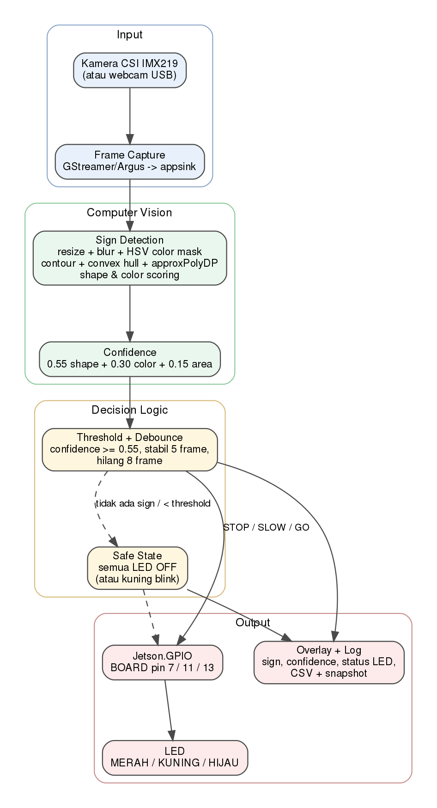
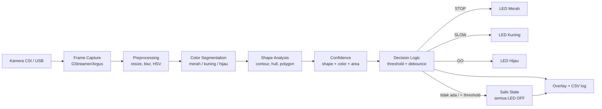
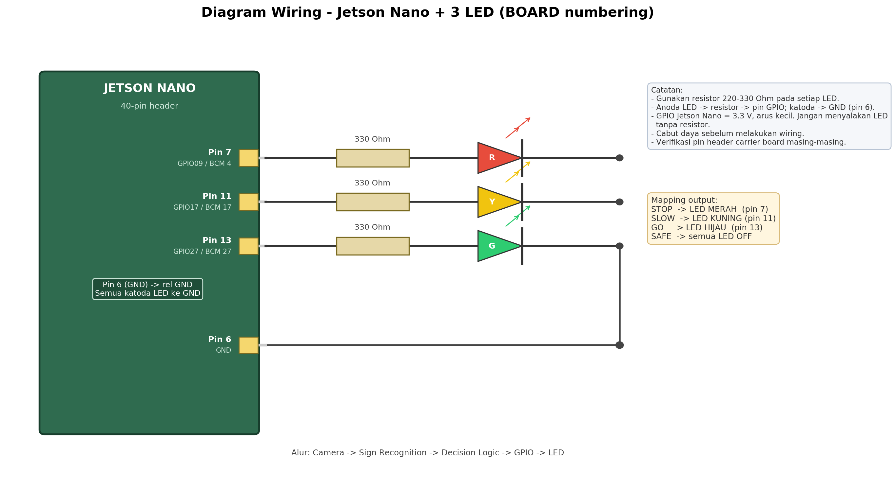

# Jetson Nano Sign Recognition + LED Control

Sistem pengenalan rambu lalu lintas berbasis **NVIDIA Jetson Nano** dan kamera
CSI. Sistem mengenali minimal tiga jenis sign, mengambil keputusan, lalu
mengendalikan tiga LED melalui GPIO dengan alur:

```
Camera -> Sign Recognition -> Decision Logic -> GPIO -> LED
```

| Sign | Ciri | Keputusan | LED |
|---|---|---|---|
| **STOP** | oktagon merah | berhenti | MERAH (BOARD pin 24) |
| **SLOW** | segitiga kuning | pelan | KUNING (BOARD pin 18) |
| **GO** | lingkaran hijau | jalan | HIJAU (BOARD pin 23) |
| tidak ada / confidence < 0.55 | - | **SAFE** | semua LED OFF |

Metode yang digunakan adalah **Computer Vision**: segmentasi warna HSV +
analisis bentuk kontur (convex hull, `approxPolyDP`, solidity, circularity,
extent). Tidak diperlukan TensorFlow/model AI, sehingga ringan dan dapat
berjalan langsung di JetPack 4.6 dengan OpenCV 3.2 bawaan.

---

## 1. Ringkasan Fitur

- Pengenalan 3 sign: STOP (merah/oktagon), SLOW (kuning/segitiga),
  GO (hijau/lingkaran).
- Nilai **confidence** 0-1 ditampilkan untuk setiap kandidat sign.
- **Decision logic** dengan threshold, debounce 5 frame, dan pelepasan sign
  setelah 8 frame hilang.
- **Safe state** yang dapat dikonfigurasi: semua LED OFF (default) atau
  kuning berkedip.
- Kontrol 3 LED melalui `Jetson.GPIO` (BOARD numbering).
- Overlay OpenCV: sign, confidence, status LED, FPS, dan alasan safe state.
- Mode **headless** (SSH/tanpa monitor) dengan log status ke terminal,
  CSV, dan snapshot JPEG otomatis.
- Sumber kamera: **CSI IMX219**, **webcam USB**, atau **file video** untuk
  demo/pengujian berulang.
- Mode simulasi GPIO untuk pengembangan tanpa hardware.
- Tool kalibrasi HSV, tes LED, evaluasi kamera, dan synthetic benchmark.

---

## 2. Spesifikasi Hardware dan Software

### Hardware

| Komponen | Spesifikasi |
|---|---|
| Komputer | NVIDIA Jetson Nano 4GB |
| Kamera | CSI IMX219 (sensor-id 0), kabel ribbon 15-pin |
| Aktuator | 3 LED (merah, kuning, hijau) |
| Resistor | 3x 1k Ohm |
| Protoboard | breadboard + kabel jumper female-female |
| Catu daya | 5V 4A via barrel jack (disarankan) |
| Opsional | webcam USB, monitor/HDMI, keyboard |

### Software

| Komponen | Versi yang diuji |
|---|---|
| OS | Ubuntu 18.04 (JetPack 4.6) |
| L4T | R32.6.1 |
| Python | 3.6.9 |
| OpenCV | 3.2.0 (bawaan JetPack) |
| NumPy | 1.13.3 |
| GStreamer / Argus | 1.14 + `nvarguscamerasrc` |
| GPIO | `Jetson.GPIO` |
| Diagram | Graphviz + Matplotlib (hanya untuk generate dokumentasi) |

> OpenCV bawaan JetPack 4.6 dibuild **tanpa GStreamer**, sehingga
> `cv2.VideoCapture(0)` tidak dapat membuka kamera CSI. Karena itu source code
> memakai PyGObject + `nvarguscamerasrc` + `appsink` untuk kamera CSI.

---

## 3. Arsitektur Sistem



Diagram sumber: [`docs/architecture.svg`](docs/architecture.svg) dan
[`docs/architecture.dot`](docs/architecture.dot).



Modul utama:

| File | Tanggung jawab |
|---|---|
| `signrec/camera.py` | CSI (GStreamer), USB, dan video file; flip gambar |
| `signrec/detector.py` | HSV mask, contour, shape scoring, confidence |
| `signrec/decision.py` | threshold, debounce, transisi ke safe state |
| `signrec/gpio_led.py` | mapping sign -> LED, GPIO/simulasi, cleanup |
| `signrec/overlay.py` | overlay status pada frame |
| `main.py` | orkestrasi seluruh pipeline + logging + snapshot |

Detail desain: [`docs/architecture.md`](docs/architecture.md).

---

## 4. Cara Kerja

1. **Capture** - kamera CSI menghasilkan frame 1280x720, `nvvidconv`
   menurunkan resolusi ke 640x360 (rasio aspek dipertahankan) dan
   mengirim BGRx ke `appsink`.
2. **Preprocessing** - resize (jika perlu), Gaussian blur 5x5,
   konversi BGR -> HSV.
3. **Color segmentation** - `cv2.inRange` untuk rentang merah (dua rentang
   hue karena wrap-around), kuning, dan hijau. Morfologi 3x3 membersihkan
   noise.
4. **Shape analysis** - contour eksternal -> convex hull ->
   `approxPolyDP` (epsilon 3% perimeter). Dihitung jumlah vertex,
   solidity, circularity, extent, dan aspect ratio.
5. **Validasi bentuk** - filter geometri menolak objek persegi panjang/
   blob pecahan:
   - STOP: oktagon (8 vertex, extent 0.55-0.96)
   - SLOW: segitiga (3-5 vertex, extent 0.32-0.72)
   - GO: lingkaran (circularity >= 0.80, extent 0.55-0.90)
6. **Confidence**:

   ```
   confidence = 0.55 * shape_score
              + 0.30 * color_score
              + 0.15 * area_score
   ```

   `shape_score` dari kecocokan vertex/circularity, `color_score` dari
   kepadatan mask di dalam bounding box, `area_score` dari luas relatif
   terhadap frame.
7. **Decision logic**:
   - Kandidat hanya diterima jika `confidence >= 0.55`.
   - Sign harus stabil **5 frame** berturut-turut sebelum mengaktifkan LED.
   - Jika sign hilang / confidence turun, sistem menunggu **8 frame**
     sebelum masuk safe state (mencegah kedip akibat noise).
   - Safe state default: **semua LED OFF**.
8. **GPIO** - `Jetson.GPIO` mode BOARD menyalakan satu LED sesuai mapping.
9. **Output** - overlay + status terminal + CSV + snapshot pada setiap
   perubahan state.

### Konfigurasi Safe State

Default di `config/config.json`:

```json
"gpio": {
  "pins": {"red": 18, "yellow": 12, "green": 16},
  "safe_state": "all_off",
  "blink_hz": 2.0
}
```

Ubah `safe_state` menjadi `"blink_yellow"` jika kelompok menentukan kondisi
aman berupa LED kuning berkedip. Semua pin dimatikan saat program keluar
(`Ctrl+C`) dan saat `GPIO.cleanup()`.

---

## 5. Wiring



Diagram sumber: [`docs/wiring.svg`](docs/wiring.svg).
Panduan lengkap: [`docs/wiring.md`](docs/wiring.md).

| Fungsi | BOARD pin | BCM | Komponen |
|---|---|---|---|
| STOP / LED merah | 24 | GPIO18 (BCM 18) | LED merah + resistor 1k Ohm |
| SLOW / LED kuning | 18 | GPIO12 (BCM 12) | LED kuning + resistor 1k Ohm |
| GO / LED hijau | 23 | GPIO16 (BCM 16) | LED hijau + resistor 1k Ohm |
| GND bersama | GND | - | katoda semua LED |

Urutan rangkaian per LED:

```
GPIO (pin 24/18/23) -> resistor 1k Ohm -> anoda LED -> katoda LED -> GND (pin GND)
```

**Peringatan:**

- Cabut daya sebelum melakukan wiring.
- Jangan menghubungkan LED langsung ke GPIO tanpa resistor.
- GPIO Jetson Nano berlogika 3.3 V dan arus kecil; gunakan resistor yang
  sesuai.
- Verifikasi pin header carrier board masing-masing. Pada board uji muncul
  peringatan `Carrier board is not from a Jetson Developer Kit` dari
  `Jetson.GPIO`; tetap ukur/verifikasi pin sebelum menghubungkan LED.

---

## 6. Instalasi

```bash
# 1. Clone repositori ini, lalu masuk ke direktorinya
cd jetson-sign-recognition

# 2. Dependensi sistem (JetPack 4.6 / Ubuntu 18.04)
sudo apt update
sudo apt install -y python3-opencv python3-numpy python3-gi \
                    gstreamer1.0-tools

# Jetson.GPIO biasanya sudah terpasang. Jika belum:
sudo apt install -y python3-jetson-gpio
# atau: sudo pip3 install Jetson.GPIO

# 3. Izinkan user mengakses GPIO (logout/login setelahnya)
sudo usermod -aG gpio $USER

# 4. Opsional: cek dependensi Python
python3 -c "import cv2, numpy, gi; print(cv2.__version__, numpy.__version__)"
```

Tidak perlu `pip install -r requirements.txt` pada JetPack karena OpenCV dan
PyGObject harus memakai paket sistem. File `requirements.txt` disediakan untuk
referensi versi.

### Cek kamera CSI

```bash
nvgstcapture-1.0 --sensor-id=0
```

atau:

```bash
gst-launch-1.0 -e nvarguscamerasrc sensor-id=0 num-buffers=30 ! \
  'video/x-raw(memory:NVMM),width=1280,height=720,framerate=30/1' ! \
  nvvidconv ! 'video/x-raw,format=I420' ! fakesink
```

### Dataset
```

Gambar untuk dataset tersimpan di `assets/dataset/`: gambar `train`/`val`/`test`, label YOLO,
`labels.csv`, `dataset.yaml`, `classes.txt`, dan `preview.jpg`. Dataset default
berisi 840 gambar 640x360 (240 per kelas + 120 background) dengan variasi
jarak, rotasi, posisi, pencahayaan, dan background. Detail ada di
`assets/dataset/README.md`.

---

## 7. Menjalankan Program

 ### Mode normal (dengan monitor)

```bash
python3 main.py
```

Tekan `q` atau `ESC` untuk keluar.

### Mode headless (SSH, tanpa monitor)

```bash
python3 main.py --headless
```

Status dicetak ke terminal, snapshot disimpan ke
`results/runtime/snapshots/`, log CSV ke `results/logs/`.

### Live camera realtime (jendela + stream web)

```bash
# jendela di HDMI + stream MJPEG di port 8000
python3 tools/live_camera.py

# tanpa monitor (SSH): stream web saja + GPIO simulasi
python3 tools/live_camera.py --no-window --simulate-gpio
```

Buka `http://<ip-jetson>:8000/` dari laptop/HP di jaringan yang sama. Overlay
deteksi, status SAFE, dan indikator LED ikut tampil di stream. Endpoint lain:
`/snapshot.jpg` (JPEG terakhir) dan `/health`. Opsi berguna: `--port`,
`--stream-width`, `--quality`, `--no-stream`, `--threshold`, `--duration`.

### Tanpa hardware GPIO (simulasi)

```bash
python3 main.py --headless --simulate-gpio
```

### Pilihan lain

```bash
# kamera USB
python3 main.py --camera usb --usb-index 0

# kamera terpasang terbalik
python3 main.py --flip rotate180

# batasi durasi (detik), berguna untuk pengujian otomatis
python3 main.py --headless --simulate-gpio --duration 10

# ubah threshold dari CLI
python3 main.py --threshold 0.60
```

> Pada rig pengujian ini kamera dipasang terbalik, sehingga
> `config/config.json` memakai `"flip": "rotate180"`. Jika kamera dipasang
> normal, ubah menjadi `"none"`.

### Demo video (STOP -> SLOW -> GO -> tanpa sign)

```bash
python3 tools/make_demo_video.py
python3 main.py --camera video --video results/demo/demo_signs.mp4 \
                --headless --simulate-gpio --duration 11
```

Demo ini menguji seluruh alur keputusan dan pergantian sign tanpa hardware
fisik. Log contoh: [`results/demo_run.log`](results/demo_run.log).

### Tes LED

```bash
# hardware asli
python3 tools/test_leds.py

# simulasi
python3 tools/test_leds.py --simulate
```

### Kalibrasi HSV (butuh display)

```bash
python3 tools/calibrate_hsv.py --color yellow
```

Atur trackbar sampai mask hanya menangkap sign, tekan `s` untuk mencetak
rentang, lalu salin ke `config/config.json` bagian `colors`.

---

## 8. Struktur Repositori

```
jetson-sign-recognition/
├── README.md
├── LICENSE
├── Makefile
├── requirements.txt
├── main.py
├── config/
│   └── config.json
├── signrec/
│   ├── camera.py
│   ├── config.py
│   ├── detector.py
│   ├── decision.py
│   ├── gpio_led.py
│   ├── overlay.py
│   ├── webstream.py
│   └── signs.py
├── tools/
│   ├── synthetic_benchmark.py
│   ├── evaluate_camera.py
│   ├── live_camera.py
│   ├── make_demo_video.py
│   ├── test_leds.py
│   └── calibrate_hsv.py
├── tests/
│   ├── test_detector.py
│   ├── test_decision.py
│   ├── test_gpio_led.py
│   └── test_webstream.py
├── docs/
│   ├── architecture.md / .png / .svg / .dot
│   ├── wiring.md / .png / .svg
│   └── testing.md
├── assets/signs/          # PNG sign siap cetak
├── assets/dataset/        # dataset berlabel (YOLO + CSV)
└── results/
    ├── synthetic/         # benchmark + screenshot sintetis
    ├── screenshots/       # bukti screenshot
    ├── demo/              # video demo
    ├── demo_run.log
    └── README.md
```

---

## 9. Pengujian

### Unit test

```bash
python3 -m unittest discover -s tests -v
# atau: make test
```

Hasil saat ini: **18 test lulus** (detector, decision logic, GPIO simulasi).

### Synthetic benchmark

```bash
python3 tools/synthetic_benchmark.py
```

Menguji 3 sign x 3 skala jarak (dekat/sedang/jauh) x 2 pencahayaan
(terang/redup) x 3 variasi rotasi/offset, plus 10 frame tanpa sign.

Hasil saat ini:

| Pencahayaan | Jarak | STOP | SLOW | GO |
|---|---|---|---|---|
| terang | dekat | 100% | 100% | 100% |
| terang | sedang | 100% | 100% | 100% |
| terang | jauh | 100% | 100% | 100% |
| redup | dekat | 100% | 100% | 100% |
| redup | sedang | 100% | 100% | 100% |
| redup | jauh | 100% | 100% | 100% |

**Akurasi total 54/54 (100%), false positive 0/10.**
Tabel lengkap + mean confidence: [`results/synthetic/summary.md`](results/synthetic/summary.md).

### Demo alur keputusan dan pergantian sign

Video demo berisi transisi STOP -> SLOW -> GO -> tanpa sign -> STOP -> tanpa
sign. Hasil eksekusi 11 detik:

- 217 frame, 19.6 FPS rata-rata.
- Distribusi: SAFE=48, STOP=83, SLOW=53, GO=33.
- LED simulasi berubah sesuai sign; kondisi tanpa sign kembali ke SAFE.
- Log: [`results/demo_run.log`](results/demo_run.log).

### Integrasi kamera CSI nyata

Uji 10 detik pada kamera IMX219 (tanpa sign fisik di depan kamera):

- 173 frame, 17.2 FPS.
- Semua frame SAFE, tidak ada false positive setelah filter geometri.
- Snapshot: [`results/screenshots/camera_safe_state.jpg`](results/screenshots/camera_safe_state.jpg).

### Pengujian minimum dengan sign fisik (wajib diisi saat hardware siap)

Matriks: **3 sign x 3 jarak x 2 pencahayaan = 18 kondisi**, ditambah uji
transisi dan kondisi tanpa sign. Gunakan:

```bash
python3 tools/evaluate_camera.py --all --seconds 4
```

atau satu kondisi:

```bash
python3 tools/evaluate_camera.py --sign STOP --distance 1.0m \
    --lighting terang --seconds 4
```

Hasil masuk ke `results/evaluation_camera.csv` dan screenshot ke
`results/screenshots/real_*.jpg`. Prosedur lengkap dan tabel isian:
[`docs/testing.md`](docs/testing.md).

**Status pengujian:**

| Item | Status |
|---|---|
| Unit test | Lulus 18/18 |
| Synthetic 3 jarak x 2 cahaya | Lulus 54/54, 0/10 false positive |
| Integrasi kamera CSI | Lulus (10 detik, safe state) |
| Alur keputusan + pergantian sign (video) | Lulus |
| LED fisik via GPIO | Lulus 3/3 |
| Matriks sign fisik 18 kondisi | Lulus 18/18 |

Foto/screenshot tersedia di [`results/screenshots/`](results/screenshots/).

---

## 10. Hasil dan Screenshot

| STOP | SLOW |
|---|---|
|  |  |

| GO | Safe state (tanpa sign) |
|---|---|
|  |  |

Contoh deteksi syntetic:
[STOP dekat](results/screenshots/synthetic_STOP_dekat.jpg),
[SLOW sedang](results/screenshots/synthetic_SLOW_sedang.jpg),
[GO jauh redup](results/screenshots/synthetic_GO_jauh_redup.jpg).

---

## 11. Troubleshooting

| Masalah | Solusi |
|---|---|
| `cv2.VideoCapture(0)` gagal membuka kamera CSI | Normal pada OpenCV 3.2 JetPack. Gunakan backend GStreamer bawaan program. |
| `nvarguscamerasrc` error / kamera sibuk | `sudo systemctl restart nvargus-daemon`, tutup proses kamera lain, cek kabel ribbon. |
| `DISPLAY` kosong / tidak ada monitor | Gunakan `--headless`; snapshot tetap disimpan. |
| `Jetson.GPIO` warning carrier board | Verifikasi pin header board Anda sebelum menghubungkan LED. |
| Permission denied GPIO | `sudo usermod -aG gpio $USER`, logout/login, atau jalankan dengan `sudo`. |
| LED tidak menyala | Cek polaritas, resistor, GND bersama, dan pin BOARD. Jalankan `tools/test_leds.py`. |
| False positive objek kuning/merah | Jalankan `tools/calibrate_hsv.py`, naikkan threshold, pastikan sign cukup besar dan bentuk tidak terhalang. |
| Sign tidak terdeteksi saat redup | Kalibrasi HSV untuk kondisi cahaya tersebut; turunkan `V min`; dekatkan sign. |
| Video demo tidak bisa dibuat | Coba codec lain: `--codec MJPG` dan ekstensi `.avi`. |

---

## 12. Limitasi dan Pengembangan

- Metode warna + bentuk rentan terhadap objek lain yang warnanya serupa;
  sistem dirancang untuk lingkungan terkontrol (sign dicetak jelas).
- Pencahayaan sangat redup atau warna sign pudar memerlukan kalibrasi HSV.
- Belum ada tracking objek; stabilitas hanya menggunakan debounce frame.
- Untuk pengembangan: MobileNet/YOLO + TensorRT, tracking (SORT/DeepSORT),
  (`camera_node`, `detector_node`, `decision_node`, `gpio_node`).

---

## 13. Lisensi

MIT - lihat [`LICENSE`](LICENSE).
